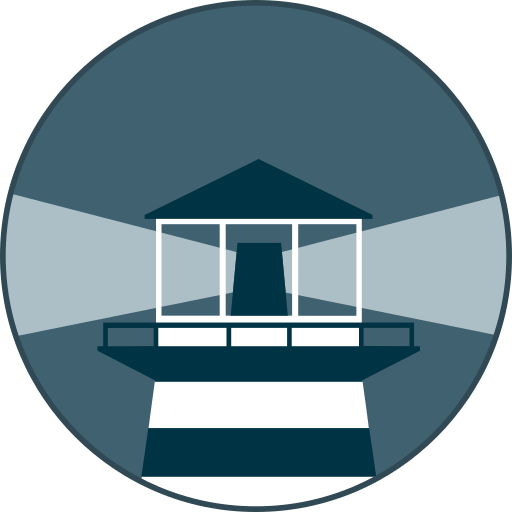

<p align="center">
  <picture>
    <source media="(prefers-color-scheme: dark)" srcset="assets/icon-dark.svg">
    
  </picture>
</p>

<h1 align="center">aac-watchtower</h1>

<p align="center">Self-hosted deployment definition for Watchtower, a tool that keeps running Docker containers up to date.</p>

<p align="center">
  <a href="https://github.com/containrrr/watchtower"></a>
  
  <a href="https://github.com/containrrr/watchtower/blob/main/LICENSE"></a>
</p>

## About

Watchtower monitors the Docker containers on a host. On a configurable interval it checks
whether the image of a running container has changed in its registry, pulls the new image,
and restarts the container with the same configuration. Replaced images can be removed
automatically to free disk space.

Key features (as provided by upstream):

- Detects and applies newer images for running containers on the same Docker host
- Configurable polling interval
- Optional cleanup of old images after an update
- Runs as a single container that talks to the Docker Engine through its socket

> **Note:** The upstream project was archived by its owner on 2025-12-17 and is no longer
> maintained (see [upstream discussion #2135](https://github.com/containrrr/watchtower/discussions/2135)).
> This deployment definition pins the last published image tag, `amd64-0.3.5`, and receives
> no upstream fixes.

## Upstream

- Project: <https://github.com/containrrr/watchtower>
- Container image: `containrrr/watchtower:amd64-0.3.5` (Docker Hub)
- License: Apache-2.0 (upstream project)

## Quick start (Docker Compose)

The Compose file is rendered from `service.yml` by the App-as-Code template engine. The
service does not use external Docker networks and does not publish any ports. It needs no
secrets, so no `.env` file is required.

```bash
docker compose up -d
```

Watchtower requires access to the Docker socket on the host (see "Volumes" below). Only run
it on hosts where that level of access is acceptable.

## Configuration

Environment variables (defaults from `service.yml`):

| Variable | Default | Description |
|---|---|---|
| `TZ` | `Europe/Berlin` | Time zone used for log timestamps |
| `WATCHTOWER_CLEANUP` | `true` | Remove old images after a container has been updated |
| `WATCHTOWER_POLL_INTERVAL` | `3600` | Interval between checks for new images, in seconds |

Ports: none.

Volumes:

| Mount | Description |
|---|---|
| `/var/run/docker.sock` -> `/var/run/docker.sock` | Docker Engine socket, used to list and update containers |

Other settings: restart policy `always`, `no-new-privileges:true`, JSON-file logging with
`max-size: 10m` and `max-file: 5`.

## Deploy with App-as-Code

1. Edit `service.yml`. It is the single source of truth for image, ports, environment,
   volumes, dependencies and per-stage overrides. Do not edit the rendered output.
2. Pushing to `main` (or a configured stage branch) runs the service pipeline, which renders
   the manifests with `aac-template-engine` and triggers the deployment.
3. Releases of this definition are published under <https://github.com/app-as-code/aac-watchtower>.

## Credits and license

Watchtower is developed by the containrrr project and licensed under Apache-2.0. This
repository only contains the deployment definition for it and is not a fork of the
application. The logo is provided by the upstream project; see
[`assets/ICON_SOURCE.md`](assets/ICON_SOURCE.md) for icon sources and licenses.
